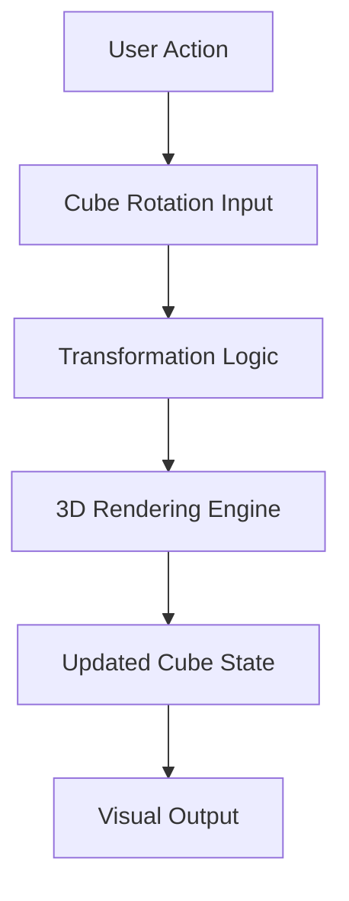
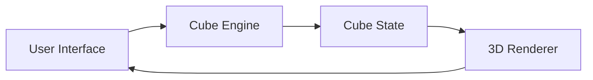

# 🧩 MindGamesCollection

A collection of interactive puzzle and mind-game projects built using web technologies.

##  Featured Project

### 3D Rubik's Cube Simulator

An interactive browser-based 3D Rubik's Cube simulation that allows users to visualize and manipulate a virtual 3×3 cube.

---

##  Preview

> Replace the images below after uploading screenshots to the repository.

### Main Interface

./assets/rubiks-preview.png

### Cube Manipulation

./assets/rubiks-rotation.gif

---

##  Live Demo

GitHub Pages:

```text
https://abhinav0singh.github.io/MindGamesCollection/
```

*(Enable GitHub Pages after pushing the project.)*

---

## ✨ Features

- 🎲 Interactive 3D Rubik's Cube
- 🔄 Smooth cube rotations
- 🎮 Browser-based experience
- ⚡ Lightweight and dependency-free
- 📱 Modern web technology implementation

---

## 🏗️ Project Structure

```text
MindGamesCollection/
│
├── 3x3Rubiks.html
├── LICENSE
├── README.md
└── assets/
    ├── rubiks-preview.png
    └── rubiks-rotation.gif
```

---

## 🧠 How It Works



---

## 🔧 Getting Started

### Clone the Repository

```bash
git clone https://github.com/abhinav0singh/MindGamesCollection.git
```

### Navigate to Project

```bash
cd MindGamesCollection
```

### Run

Simply open:

```text
3x3Rubiks.html
```

in any modern browser.

---

## 🎮 Controls

| Action | Description |
|----------|-------------|
| Mouse Drag | Rotate View |
| Keyboard Inputs | Execute Cube Moves |
| Reset Button | Restore Initial State |

> Update this section based on the actual controls implemented.

---

## 🏛️ Architecture



---

## 🔮 Future Enhancements

- ✅ Move history tracking
- ✅ Cube scrambling
- ✅ Solve algorithm visualization
- ✅ Performance optimization
- ✅ Mobile-friendly controls
- ✅ Multi-sized cubes (2x2, 4x4, 5x5)

---

## 🛠️ Built With

- HTML5
- CSS3
- JavaScript
- Browser Rendering APIs

---

## 📚 Learning Resources

- [Rubik's Cube Notation Guide](https:tation/
- [CFOP Method](https://jperm.net/3x3/cs Documentation](https://threejs.org/docs/) *(if used)*

---

## 📄 License

This project is licensed under the MIT License.

See the LICENSE file for details.

---

## 👨‍💻 Author

**Abhinav Singh**

GitHub: https://github.com/abhinav0singh

---

## ⭐ Support

If you find this project useful:

- Star the repository ⭐
- Fork it 🍴
- Share it with other puzzle enthusiasts 🧩
